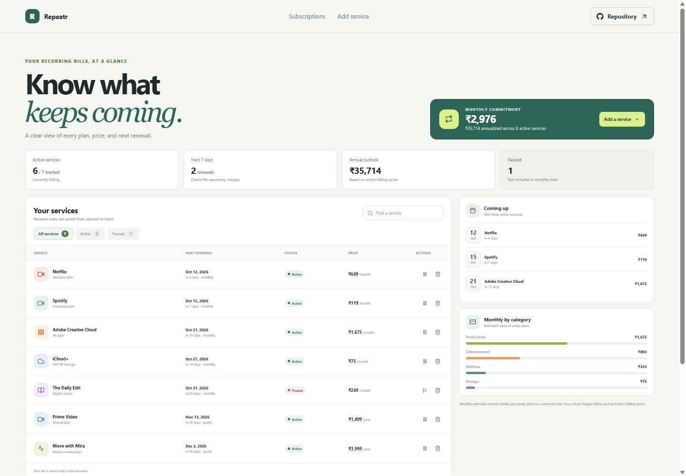

# Repeatr: Subscription Manager

Repeatr brings recurring services into one renewal list, with monthly estimates and an at-a-glance view of upcoming charges.

Deployed site: https://a2rp.github.io/subscription-manager/

## Included

- Track service names, categories, prices, billing cycles, and renewal dates.
- Compare recurring costs with a monthly estimate and annual outlook.
- See upcoming renewals and active spending by category.
- Add services, search the list, and filter active or paused plans.
- Pause or resume a plan and confirm before removing a service.

## How to use it

Review services by their next renewal date. Use the search and status filters to narrow the list. Pause a plan to remove it from cost estimates, or use the form below the list to add a recurring service.

## Data and limits

The list is saved in this browser with localStorage. It does not sync across devices. Example subscriptions are demonstration data. Monthly and annual totals are estimates that normalize each active billing cycle; actual provider charges can differ.

## Run locally

Run npm install, then npm run dev to start the Vite development server.

## Checks and deployment

Run npm run lint and npm run build before deployment. Run npm run deploy to publish the dist directory to the gh-pages branch after configuring the public repository as origin and enabling GitHub Pages for that branch.

## Future improvements

Ideas only. These are not implemented yet:

- Add reminders before renewal dates.
- Add an exportable spending report and billing history.
- Add optional currency selection for non-INR services.

## Links

- Portfolio: [https://www.ashishranjan.net](https://www.ashishranjan.net)
- GitHub: [https://github.com/a2rp](https://github.com/a2rp)
- CodePen: [https://codepen.io/ash1198](https://codepen.io/ash1198)
- LinkedIn: [https://www.linkedin.com/in/aashishranjan](https://www.linkedin.com/in/aashishranjan)
- Facebook: [https://www.facebook.com/theash.ashish/](https://www.facebook.com/theash.ashish/)
- YouTube: [https://www.youtube.com/@ashishranjan-ashz?sub_confirmation=1](https://www.youtube.com/@ashishranjan-ashz?sub_confirmation=1)
- Email: [mailto:ash.ranjan09@gmail.com](mailto:ash.ranjan09@gmail.com)

## Support

- Support: [https://a2rp-donation-page.netlify.app/](https://a2rp-donation-page.netlify.app/)
- Buy Me a Coffee: [https://buymeacoffee.com/ashishranjan](https://buymeacoffee.com/ashishranjan)
- Patreon: [https://www.patreon.com/ashishranjan](https://www.patreon.com/ashishranjan)